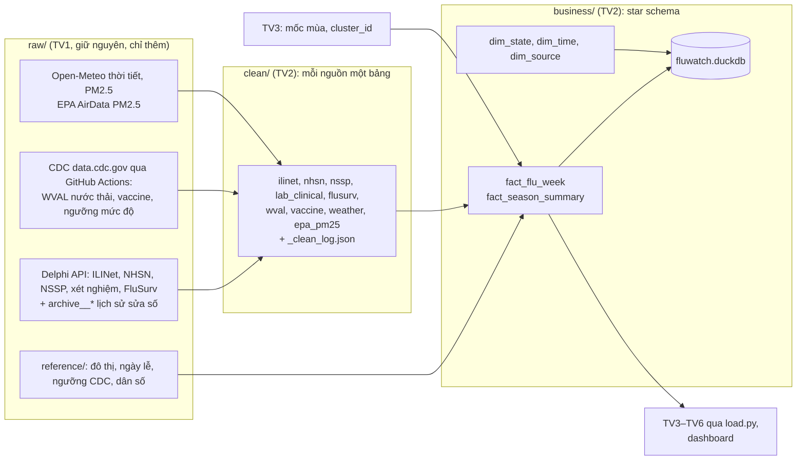

# Quản trị dữ liệu

> 📍 [Mục lục tài liệu](README.md) · Từ điển và lineage từng cột: [tu_dien_du_lieu.md](tu_dien_du_lieu.md) · Báo cáo chất lượng: [../reports/data_quality/README.md](../reports/data_quality/README.md) · Bảo toàn dữ liệu thô: [bao_toan_du_lieu.md](bao_toan_du_lieu.md)

Cập nhật 16/11/2026. TV2 giữ file này. Tài liệu trả lời bốn câu hỏi: ai chịu trách nhiệm nguồn nào (mục 1), dữ liệu chảy qua những tầng nào (mục 2), số liệu gần đây được cập nhật và sửa thế nào (mục 3), chất lượng được kiểm tra ra sao (mục 4).

## 1. Người phụ trách từng nguồn

Ba vai trò:

- **Owner** (người phụ trách thu thập): giữ script tải, lịch tải, file `raw/`; nguồn đổi định dạng hoặc ngừng thì owner sửa.
- **Steward** (người quản lý dữ liệu): làm sạch `raw/` → `clean/` → `business/`, giữ từ điển dữ liệu và quy tắc chất lượng; số trong `business/` sai thì steward sửa.
- **Users** (người dùng): đọc qua `fluwatch.warehouse.load`, không sửa `clean/`, `business/`; thấy số lạ thì báo steward kèm (bang, tuần, cột).

Nguồn sự thật là bảng `dim_source` trong `data/business/` (khai báo ở `SOURCES`, `src/fluwatch/warehouse/business.py`). Bảng dưới được chép lại từ `dim_source` mỗi lần chạy `--steps docs`; muốn đổi người phụ trách thì sửa `SOURCES` rồi chạy lại, đừng sửa tay bảng dưới. Quy tắc Q04 báo lỗi khi một nguồn thiếu owner hoặc steward.

<!-- BEGIN dim_source (sinh tu dong, khong sua tay) -->
| Nguồn (`source_id`) | Cung cấp | Owner | Steward | Users | Có sửa số cũ | Quy tắc cập nhật | Kỳ có trong `clean/` |
| --- | --- | --- | --- | --- | --- | --- | --- |
| ILINet (FluView) (`ilinet`) | CDC qua Delphi Epidata V5 | TV1 | TV2 | TV3, TV4, TV5, TV6 | có | thu Bay; tai lai ca lich su, 4 tuan gan nhat la so bo | 2010-10-09 → 2026-11-07 |
| NHSN nhap vien cum (`nhsn`) | CDC qua Delphi Epidata V5 | TV1 | TV2 | TV5, TV6 | có | thu Bay; tai lai ca lich su, 4 tuan gan nhat la so bo | 2020-08-08 → 2026-11-07 |
| NSSP cap cuu (`nssp`) | CDC qua Delphi Epidata V5 | TV1 | TV2 | TV3 (8 bang thieu ILINet), TV5, TV6 | có | thu Bay; tai lai ca lich su, 4 tuan gan nhat la so bo | 2022-10-01 → 2026-11-07 |
| Xet nghiem lam sang (FluView) (`lab_clinical`) | CDC qua Delphi Epidata V5 | TV1 | TV2 | TV5, TV6 | có | thu Bay; tai lai ca lich su | 2016-10-08 → 2026-11-07 |
| FluSurv-NET (`flusurv`) | CDC qua Delphi Epidata V5 | TV1 | TV2 | TV5 (doi chieu) | có | thu Bay; tai lai ca lich su | 2003-10-04 → 2026-11-07 |
| Nuoc thai WVAL cum A (`wval`) | CDC NWSS (data.cdc.gov) | TV1 | TV2 | TV5, TV6 | có | thu Bay (crawl_cdc.yml); moi lan tai la ca lich su, moi tuan dung ban moi nhat | 2022-01-01 → 2026-11-07 |
| Do phu vaccine cum (FluVaxView) (`vaccine`) | CDC (data.cdc.gov) | TV1 | TV2 | TV4 (what-if), TV6 | có | hang thang; gan cho moi tuan cua mua | 2009-10 → 2025-26 |
| Thoi tiet + PM2.5 Open-Meteo (`weather`) | Open-Meteo | TV1 | TV2 | TV4, TV6 | không | thu Bay; tai lai 35 ngay gan nhat | 2010-01-02 → 2026-11-07 |
| EPA AirData PM2.5 (88101) (`epa`) | US EPA | TV1 | TV2 | TV4 | có | tai lai file nam hien tai khi EPA cap nhat (tre vai thang) | 2010-01-02 → 2026-05-30 |
| Dan so 2020 (`population`) | Census qua Delphi | TV1 | TV2 | ca nhom (roll-up co trong so) | không | khong doi | – |
| Ngay le va ky nghi dong (`holidays`) | Nhom tu lap | TV1 | TV2 | TV4 | không | khong doi | – |
| Nguong muc do nhap vien CDC (`cdc_thresholds`) | CDC (trang phuong phap HRD) | TV1 | TV2 | TV5 (nhan), TV6 (den canh bao) | không | khi CDC doi nguong | – |
<!-- END dim_source -->

TV1 là owner mọi nguồn vì TV1 dựng toàn bộ phần thu thập; TV2 là steward. Sản phẩm do thành viên khác giao (mốc mùa, `cluster_id` của TV3; dự báo của TV5; what-if của TV4) thì thành viên đó là owner, TV2 chỉ ghép vào kho (`docs/ke_hoach.md` mục 7).

## 2. Các tầng dữ liệu và lineage

| Tầng | Nội dung | Quy tắc |
| --- | --- | --- |
| `raw/<nguồn>/<ngày tải>/` | File gốc đúng như nguồn trả về, kèm `raw/manifest.jsonl` (URL, thời điểm, sha256) | Không sửa, không xóa; tải lại thì thêm thư mục ngày mới hoặc file `_HHMMSS` |
| `clean/<bảng>.parquet` | Mỗi nguồn một bảng: mã bang chuẩn, tuần MMWR, mùa, đơn vị; chỉ 50 bang + DC | Mọi thao tác bỏ dòng, đặt thiếu, bỏ trùng đều ghi vào `clean/_clean_log.json` kèm số dòng |
| `business/` | Star schema 5 bảng + DuckDB | Chỉ ghép, tính cột phái sinh; giá trị nguồn phải bằng đúng `clean/` (quy tắc M03) |
| `sandbox/` (TV4, TV5) | Dữ liệu giả lập, chèn lỗi, what-if | Luôn có `is_synthetic`, `sim_scenario`, `sim_seed`; không bao giờ ghép vào `business/` |

**Lineage từng cột** (cột đến từ file raw nào, qua phép biến đổi nào) nằm ở cột "Lineage" của [tu_dien_du_lieu.md](tu_dien_du_lieu.md). Từ điển đó được sinh từ `src/fluwatch/warehouse/catalog.py`, và quy tắc Q06 kiểm tra mỗi lần chạy rằng mọi cột trong Parquet đều đã được mô tả. Lineage ở mức dòng có hai chỗ để truy ngược:

- `issue_date` trong `fact_flu_week`: ngày công bố mới nhất của các tín hiệu Delphi trong dòng đó.
- `dim_source.raw_files` và `clean/_clean_log.json`: file raw cụ thể đã được đọc và từng bước biến đổi (ví dụ "bỏ 16 trạm WVAL > 1000 ở VA").

## 3. Quy tắc cập nhật 4 tuần gần nhất

### 3.1. Vì sao 4 tuần

CDC công bố số liệu tuần ngay sau khi tuần kết thúc, rồi tiếp tục sửa khi bệnh viện, phòng khám báo cáo bổ sung. Đo từ lịch sử sửa số của Delphi (`raw/*/archive__*`, các tuần từ 10/2023, so bản công bố ở mỗi độ trễ với bản cuối cùng):

| Độ trễ từ tuần số liệu đến lần công bố | NHSN nhập viện: lệch trung vị / % bang-tuần lệch > 5% | ILINet ILI%: lệch trung vị / % lệch > 5% | NSSP cấp cứu: lệch trung vị / % lệch > 5% |
| --- | --- | --- | --- |
| 0 tuần (bản đầu) | 3,4% / 40% | 0,4% / 17% | 2,9% / 34% |
| 1 tuần | 1,4% / 27% | 0,2% / 11% | 0,8% / 13% |
| 2 tuần | 1,2% / 22% | 0,1% / 7% | 0,3% / 7% |
| 3 tuần | 0,5% / 17% | 0,0% / 6% | 0,2% / 4% |
| 4 tuần | 0,3% / 14% | 0,0% / 5% | 0,1% / 4% |
| 8 tuần | 0,0% / 12% | – | 0,0% / 5% |

Sau 4 tuần, ILINet và NSSP gần như ổn định. NHSN vẫn còn khoảng 12–14% bang-tuần bị sửa trên 5%, chủ yếu ở các bang nhỏ và ngoài mùa cúm khi số ca thấp. Báo cáo chất lượng cũng thấy điều này trực tiếp: so với bản chụp NHSN HRD tải tay 01/11, tổng 51 bang khớp từng ca ở mọi tuần cũ, chỉ lệch ở 4 tuần cuối của bản chụp (quy tắc M01, M02).

### 3.2. Quy tắc

1. **Tải lại toàn bộ lịch sử mỗi tuần.** `weekly_update.yml` chạy 04:17 sáng thứ Bảy giờ Việt Nam (dự phòng Chủ nhật), `crawl_cdc.yml` chạy 02:17 cùng ngày. Delphi trả về bản mới nhất của mọi tuần; file cũ vẫn giữ trong `raw/<nguồn>/<ngày tải cũ>/`.
2. **Mỗi (bang, tuần) chỉ giữ bản công bố mới nhất** trong `clean/` và `business/` (bỏ trùng theo `report_time`). Với nước thải, tuần nào có trong lần tải mới thì dùng lần tải mới, lần tải cũ chỉ bù những tuần lần mới không còn.
3. **4 tuần gần nhất gắn `is_preliminary = True`** (tính từ tuần mới nhất của ILINet, NHSN, NSSP; quy tắc R08 kiểm tra). `_business_meta.json` ghi `preliminary_from`.
4. **Người dùng xử lý tuần sơ bộ như sau:**
   - Dashboard (TV6): vẽ nét đứt và ghi nhãn "sơ bộ"; không tô màu cảnh báo chắc chắn chỉ dựa trên tuần sơ bộ.
   - Mô hình (TV5): khi backtest, dùng số liệu **đúng như lúc công bố** (`raw/*/archive__*`, lọc `report_time ≤` ngày dự báo), không dùng `business/` vì `business/` đã chứa số sửa về sau.
   - Phân tích mùa (TV3, TV4): mốc mùa, mức nền, hồi quy chỉ dùng tuần không sơ bộ; tuần sơ bộ chỉ dùng để mô tả "hiện tại".
5. **Không chép số tay.** Mọi số trong báo cáo, slide lấy từ tag `v2026-11-19` (khóa số liệu 19/11 18:00, `docs/ke_hoach.md` mục 6). Sau khi khóa, số của các tuần sơ bộ lúc đó có thể khác số trên Hugging Face về sau; đó là sửa số của CDC, không phải lỗi.
6. **Số tuần sơ bộ là tham số** `PRELIM_WEEKS = 4` trong `business.py` và `load.py`. Muốn đổi (ví dụ 6 tuần cho NHSN) thì báo người quản lý tiến độ vì ảnh hưởng dashboard và mô hình.

### 3.3. Các nguồn không theo nhịp tuần

| Nguồn | Cập nhật | Xử lý |
| --- | --- | --- |
| Vaccine (`vh55-3he6`) | Hằng tháng trong mùa | Lấy tháng cuối có số của mùa, gán cho mọi tuần của mùa. Đây là số cuối mùa nên **không dùng làm biến dự báo** cho các tuần đầu mùa; dùng `flu_vax_pct_prev` (độ phủ cuối mùa trước) |
| EPA PM2.5 | Trễ vài tháng | Tuần chưa có EPA dùng Open-Meteo; cột `pm25_source` ghi nguồn |
| Thời tiết Open-Meteo | Tải lại 35 ngày gần nhất mỗi tuần | Không sửa số cũ |
| Ngưỡng mức độ CDC | Khi CDC đổi trang phương pháp | `crawl_cdc.yml` tải lại trang; `cdc_level` tính lại khi dựng `business/` |

## 4. Chất lượng dữ liệu

- **Chạy mỗi lần dựng kho**: `python pipelines/02_warehouse.py` (bước `quality`) chạy 28 quy tắc ở 4 mức (giá trị, bản ghi, quan hệ, nhiều bảng) và báo cáo độ phủ bang × năm, xuất [reports/data_quality/README.md](../reports/data_quality/README.md), `violations.csv` (từng ô vi phạm), `coverage_state_year.csv` và `results.json` (cho trang "Sức khỏe dữ liệu" của dashboard).
- **Cổng chất lượng**: `--strict` thoát mã 1 khi có quy tắc mức `loi` không đạt; dùng trong workflow trước khi đẩy `business/` lên Hugging Face.
- **Bộ kiểm tra được kiểm tra**: `--steps inject` chèn 4 loại lỗi (thiếu ngẫu nhiên, mất khối, trùng dòng, số sơ bộ bị sửa) có đáp án và chấm recall, báo động giả ([injection_test.md](../reports/data_quality/injection_test.md)). Bộ lỗi của TV4 đặt ở `data/sandbox/corrupted/` (`fact_flu_week.parquet` + `answer_key.csv` gồm `error_id, error_type, state, week, column`) thì được chấm trước.
- **Xử lý vi phạm**: steward xem báo cáo sau mỗi lần chạy. Lỗi do làm sạch thì sửa trong `src/fluwatch/warehouse/`; lỗi do nguồn thì ghi vào [han_che_du_lieu.md](han_che_du_lieu.md) và báo người dùng bị ảnh hưởng. Không sửa tay file Parquet.

## 5. Phiên bản, truy cập, giấy phép

- Dữ liệu dùng chung chỉ qua Hugging Face `DragonBornRay/FluDataset`; mỗi lần cập nhật hằng tuần gắn tag `vYYYY-MM-DD` (chi tiết: [bao_toan_du_lieu.md](bao_toan_du_lieu.md)).
- Chỉ TV2 ghi vào `data/clean/`, `data/business/`; thành viên khác giao file kết quả để TV2 ghép (`docs/ke_hoach.md` mục 7).
- **Hợp đồng cột** (`docs/ke_hoach.md` mục 4.1, đánh dấu ★ trong từ điển): thêm cột thì được; đổi tên hoặc bỏ cột phải báo người quản lý tiến độ trước.
- Giấy phép theo từng nguồn (cột `license` của `dim_source`): CDC, Census, EPA là dữ liệu công cộng; Delphi cần trích dẫn; Open-Meteo CC BY 4.0, ghi "Weather data by Open-Meteo.com".
